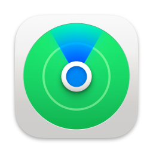
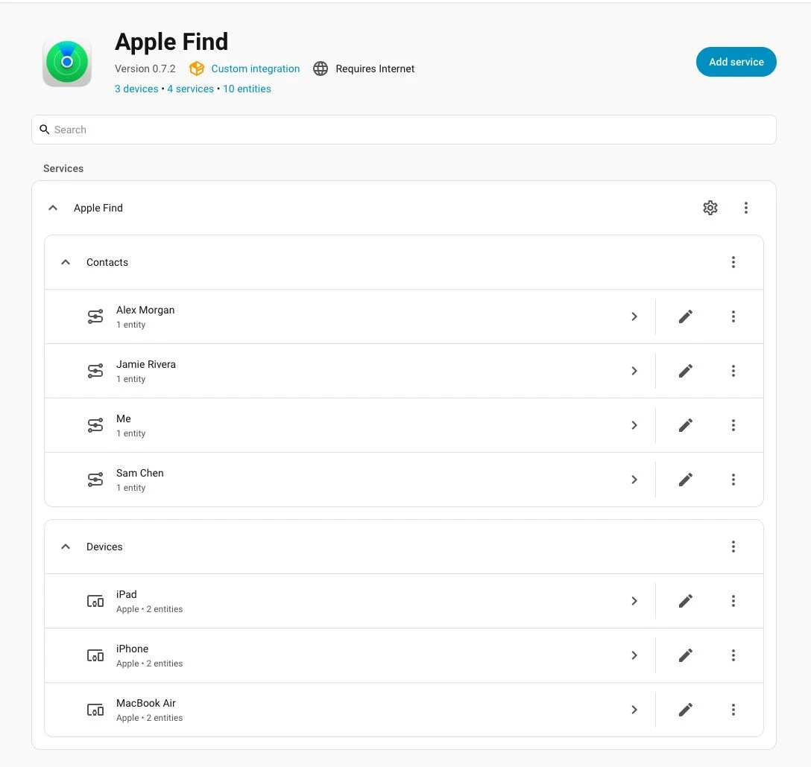
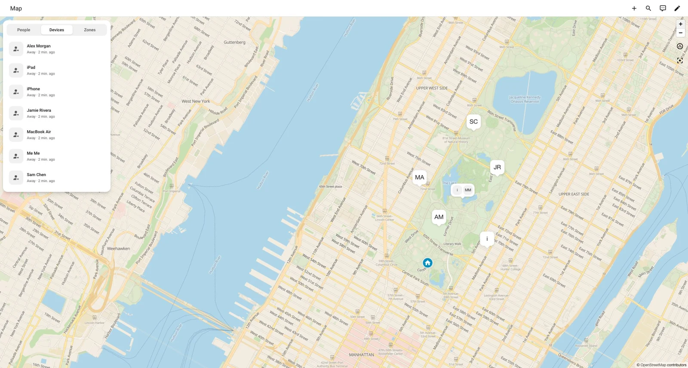
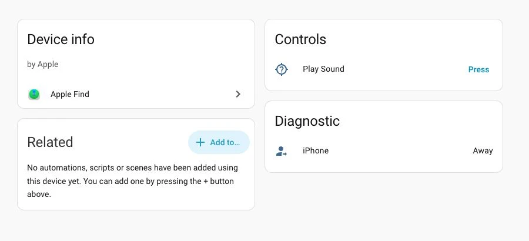

# Apple Find for Home Assistant



Apple Find is a custom integration for Home Assistant Core. Its People and Devices clients share one Apple session, provisioned CoreADI state and APNs identity on the HA host. The People client receives contact share keys via Apple push. A SearchParty notification prompts it to check for new location reports from existing shares. The Devices client polls Apple's native device service and discovers trackers that provide usable locations.

**Common uses**

- **Find a misplaced device by sound.** Press **Play Sound** in Home Assistant to make a supported Apple device ring and help you locate it nearby.
- **Check where you left a device.** See the last reported location of your iPhone, iPad, or Mac on the Home Assistant map.
- **See where family and friends are.** View the latest locations of people who already share their location with you through Apple Find My.

> [!TIP]
> See where your Apple Find contacts and devices have been with [Location History Card](https://github.com/tellok/ha-location-history-card). Scrub a shared timeline to compare their tracks, or select a time range to replay on the map.

## Screenshots

These screenshots use fictional contacts, devices, and locations around Central Park.

### Contacts and devices



### Map



### Play Sound



## Status

Verified on Linux/aarch64 on the Home Assistant host:

- Provision an emulated macOS ADI identity and generate anisette headers.
- Obtain Apple validation data for IDS registration.
- Activate a receiver certificate and establish a TLS-verified APNs connection with a courier token.
- Authenticate an Apple Account with trusted-device 2FA and receive both `mmeFMFAppToken` and `searchPartyToken`.
- Register a Linux IDS receiver for Find My and confirm the receiver's courier token and secure location capabilities through Apple's IDS directory.
- Connect to APNs using a signed connect frame and the existing receiver certificate and token. Verify that the IDS directory returns the public device key and signed prekey corresponding to the Linux receiver's local keys.
- Resolve an existing share through the native Find My People service and submit an accepted SearchParty key-distribution request.
- Receive and authenticate a real Find My IDS message for the configured share, then decrypt its P-224 location key. The observed message used NGM validator version 13.
- Fetch and decrypt fresh location reports with that key. The encrypted payload uses seconds since 2001, and the outer gateway timestamp uses Unix milliseconds. The collector uses the encrypted timestamp, verifies report identity, and publishes latitude, longitude, horizontal accuracy and the optional native floor.

The current macOS Find My daemon was observed issuing `SubscribeAndFetch` with the context `com.apple.findmy.findmylocateagent`. Its request obtains the client ID from AuthKit's device UUID and the token from FindMyDevice's APNs public token. The latter is formatted as uppercase hex, verified against the native formatter with synthetic data. The collector uses these representations and the account's native Friends service hostname.

## Components

- `scripts/apple_probe.py` runs GrandSlam and a scoped MobileMe login with an interactive 2FA prompt. It saves session state and removes the password from the saved account.
- `scripts/emulated_anisette.py` obtains a new OTP as needed from the bundled CoreADI emulator. Home Assistant creates a new ADI identity during first sign-in and stores it with the Apple session.
- `scripts/people_bootstrap.py`, `scripts/ids_enroll.py`, `scripts/ids_register.py` and `scripts/ids_receiver.py` implement the IDS delegate, certificate, registration and receipt stages.
- `custom_components/apple_find/backend` implements native People, Devices, and Apple authorization. HA Core owns the collectors. Both use one CoreADI provider and discover contacts and devices for the authorized account.
- `custom_components/apple_find/device_tracker.py` validates normalized location snapshots. When a collector writes new location data, it immediately notifies Home Assistant to refresh the affected trackers. Device discovery runs every 120 seconds under normal conditions. Apple’s shared contact list is refreshed every five minutes. For automatically discovered contacts, the collector checks for location reports every 15 seconds. An account-wide SearchParty notification immediately queues a check of existing shares. Notifications received during a check queue one follow-up as soon as the collector is available. A notification can concern other Find My activity, and Apple may return the previous report. Requests back off on service errors.
- The command-line probes in `scripts` can still be used independently for development.

The emulation and native protocol probes reference the [Zerotistic protocol analysis](https://zerotistic.blog/posts/find-my-people-linux/), [pypush](https://github.com/JJTech0130/pypush), [rustpush](https://github.com/stek29/rustpush) and [os-findmy-e](https://github.com/sacca97/os-findmy-e). See [bundled assets and sources](custom_components/apple_find/assets/README.md).

Apple Find's original code and documentation are available under the [MIT License](LICENSE). Bundled third-party code, binaries, certificates, and artwork remain subject to their respective terms. See the [bundled asset notes](custom_components/apple_find/assets/README.md) for source and license information.

## Test

```sh
docker build -f research/Dockerfile -t findmy-people-research:local .
docker run --rm -v "$PWD:/workspace:ro" findmy-people-research:local python -m pytest -q -p no:cacheprovider
```

## Home Assistant setup

On Home Assistant 2026.11 or later, open **Settings → Marketplace → Add from link** and enter `https://github.com/tellok/ha-apple-find`. Install **Apple Find** and restart Home Assistant when prompted.

[](https://my.home-assistant.io/redirect/marketplace_repository/?owner=tellok&repository=ha-apple-find&category=integration)

The installation includes the integration code, brand assets, CoreADI emulator and library, Apple trust roots, and enrollment resources. On first sign-in, HA provisions a new ADI identity and stores it in `.findmy-people-headless/state` under its configuration directory. This directory also holds the Apple session, registration keys, contact share keys, and location snapshots. Preserve it when updating an existing Apple Find installation.

To match Find My sharing emails and phone numbers to names, optionally enter an [Apple app-specific password](docs/icloud-app-specific-password.md) for the same account during setup or in the Apple Find integration options. The password is stored in the integration options so Apple Find can refresh the names. Display names are editable in HA, and existing entity IDs are retained.

Use **Settings → Devices & services → Add integration → Apple Find** to sign in with an Apple Account and the six-digit code shown on a trusted device. Home Assistant automatically discovers devices and contacts who already share their location with this Apple account. Each discovered contact gets a tracker. The Me tracker follows the device selected in Find My to share your location. Apple may supply only a sharing email address or phone number, which becomes the initial entity name. A contact can appear as unavailable while Apple has no usable recent location. Existing manually configured contacts keep their entities. For an expired session, open the reauthentication flow from **Repairs** when HA posts a notification. **Reconfigure** opens the same login form. Login passwords are excluded from saved state.

Open a tracked device in **Apple Find → Devices** to use its **Play Sound** button. The button appears when Apple advertises the sound capability. Home Assistant checks the device's current Apple identifier and sends the native command when the button is pressed.

## Troubleshooting and logs

In **Settings → Devices & services → Apple Find**, open the integration's menu and select **Enable debug logging**. Reproduce the problem, then select **Disable debug logging** to download the log. For missing or stale locations, leave it enabled for at least five minutes so the log can include a contact discovery cycle.

The following DEBUG messages trace a contact update from the push receiver to the HA tracker.

| Event | What to check |
| --- | --- |
| `searchparty_hint` | An account-level push arrived. `newly_requested` counts contact checks added and `already_pending` counts those already queued. |
| `push_refresh` or `scheduled_refresh` | A check started. Match its temporary `share_slot` with the `completed`, `waiting_for_share_key`, or `request_error` for the same check. Slots are reassigned when the collector restarts. |
| `fetch_location` and `snapshot` | Check the request duration and status, then the snapshot result. `updated` means a newer report was written, `already_current` means the stored timestamp was at least as recent, and `no_fresh_supported_report` means no returned report passed validation. `report_age_seconds` gives the age of the selected report. |
| `Apple Find contact trackers refreshed` | HA read the snapshots. The counts show how many positions changed and how many snapshots were missing or rejected. |

For device updates, inspect `device_poll` for the fetch duration, number of usable positions, and number of changed report timestamps. The subsequent HA device snapshot log shows how many positions passed validation.

To keep a particular level across restarts, use Home Assistant's [Logger integration](https://www.home-assistant.io/integrations/logger/) in `configuration.yaml`. Merge this into your existing `logger:` section if you have one:

```yaml
logger:
  logs:
    custom_components.apple_find: debug
```

You can also change the same logger at runtime with the `logger.set_level` action. INFO covers startup, successful authorization, and connection recovery. WARNING identifies failures such as a disconnected push receiver or a rate-limited query, with the retry delay where available. An unexpected runtime exit after startup is logged at ERROR with the failing integration function and line when available.

When reporting an issue, include your Home Assistant and Apple Find versions, the approximate time of the problem, and the lines from `custom_components.apple_find` and its submodules. Apple Find logs counts, status codes, and retry times. Review the download before sharing because it may contain messages from other Home Assistant integrations. Never attach your Apple Find state directory or Home Assistant backups.

## Migrating older installations

Starting with 0.6.0, the Home Assistant domain is `apple_find`. Existing installations must migrate their registries before starting Home Assistant with the new release. The script also migrates the Marketplace record so it can recognize the new domain, and handles older deployments that still use the separate native Devices integration.

1. Stop Home Assistant Core and any standalone Apple Find collectors.
2. From this repository, run `python3 scripts/migrate_ha_registry.py /config /config/private-migration-backup` against the HA configuration directory to preview the migration. Run it again with `--apply` to write the changes and save the original registries to a new backup directory.
3. Extract `apple_find.zip` from the release into `/config/custom_components/apple_find`. Move the old `apple_findmy_people` and, if present, `apple_findmy_native_devices` code directories outside `custom_components`, then start Core. If you use Marketplace, refresh the repository and install the same release there to record the installed version.

The migration preserves config entry IDs, entity IDs, device IDs, and Apple session state. Keep the backup until you verify the installation. To roll back, stop Core, run the script with `--restore`, and reinstall the previous integration code before starting Core.
